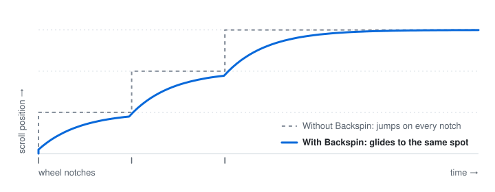

<div align="center">

# Backspin

**A tiny macOS helper that reverses and smooths scrolling for wheel mice, and leaves your trackpad alone.**

[](#install)
[](main.swift)
[](#privacy-and-security)
[](LICENSE)

<picture>
  <source media="(prefers-color-scheme: dark)" srcset="docs/glide-dark.svg">
  
</picture>

</div>

## Why

macOS has a single **Natural scrolling** switch for both the trackpad and the mouse. Turn it on and the trackpad feels right but the mouse wheel feels backwards; turn it off and it's the other way round. On top of that, a mouse wheel moves the page in jumps, one per notch, while the trackpad glides.

Backspin fixes both, for the mouse only:

- **Mouse wheel and horizontal wheel:** reversed to traditional scrolling, and smoothed so every notch glides.
- **Trackpad and Magic Mouse:** untouched. They keep natural scrolling exactly as macOS does it.
- **Shift + wheel:** scrolls sideways.
- **⌘, ⌃ or ⌥ + wheel:** reversed but not smoothed, so zooming in design and map apps stays precise.
- **In step with your display:** each glide runs at the refresh rate of the screen the pointer is on: 120 Hz on ProMotion, 60 Hz on most external monitors.

It's one Swift file of about 250 lines, using only Apple's own frameworks. There's no settings window, no menu bar icon, no network access and nothing to update. You can read all of it before you give it Accessibility access.

## Install

You need macOS 14 (Sonoma) or later and Apple's command line tools. If you don't have them, `xcode-select --install` installs them.

```bash
git clone https://github.com/baseddesigner/backspin.git
cd backspin
./install.sh
```

The installer builds `Backspin.app` into `~/Applications`, signs it, and starts it now and at every login.

### Give it Accessibility access

Backspin has to be allowed to change scroll events, which macOS controls under Accessibility. You only do this once.

1. Open **System Settings → Privacy & Security → Accessibility**.
2. Drag `~/Applications/Backspin.app` into the list. Or click **+**, press **⌘⇧G**, type `~/Applications` and choose Backspin.
3. Make sure its switch is on.

Backspin starts working within about two seconds. macOS often doesn't list a self-built app on its own, so adding it by hand is normal.

### Update

```bash
cd backspin
git pull
./install.sh
```

Updates keep the Accessibility permission. The first install creates a signing certificate on your Mac, in `signing/`, and every rebuild reuses it, so macOS recognises each new build as the same app.

## Settings

Change a value, then restart Backspin:

```bash
defaults write io.github.baseddesigner.backspin smoothing 0.12
```
```bash
launchctl kickstart -k gui/$(id -u)/io.github.baseddesigner.backspin
```

| Setting | Default | What it does |
| --- | --- | --- |
| `smoothing` | `0.08` | How long each glide lasts, in seconds. Higher feels floatier. |
| `step` | `35` | Minimum pixels a single notch scrolls. |
| `speed` | `3` | Multiplier on macOS's own acceleration when you spin the wheel fast. |
| `smooth` | `true` | Set to `false` to only reverse, without smoothing. |
| `reverseVertical` | `true` | Reverse the main wheel. |
| `reverseHorizontal` | `true` | Reverse the horizontal (thumb) wheel. |
| `debug` | `false` | Log every wheel event to `/tmp/backspin.log`. |

Use `-bool` for the on/off settings, for example `defaults write io.github.baseddesigner.backspin smooth -bool false`. To go back to all defaults, run `defaults delete io.github.baseddesigner.backspin` and restart it.

## Troubleshooting

**Backspin isn't in the Accessibility list.**
That's normal for an app you built yourself. Drag `~/Applications/Backspin.app` into the list, as described in [Give it Accessibility access](#give-it-accessibility-access).

**It's switched on, but scrolling hasn't changed.**
Check what Backspin last reported:

```bash
tail -n 3 /tmp/backspin.log
```

If it says `waiting for Accessibility permission`, macOS is holding on to an outdated entry. Select Backspin in the Accessibility list, remove it with **−**, then drag the app in again and switch it on. If that doesn't help, reset its permission and add it again:

```bash
tccutil reset Accessibility io.github.baseddesigner.backspin
```

**It stopped working after I rebuilt it.**
The `signing/` folder was probably deleted, so the installer made a new certificate and macOS treats the build as a different app. Remove Backspin from the Accessibility list and add it again. Keep `signing/` from then on.

**Scrolling feels doubled, too fast, or reversed twice.**
Another scroll tool is probably running too, such as Mos, Scroll Reverser, Mac Mouse Fix or Logitech Options+. Quit it, or turn off its smoothing and scroll reversing.

**It's too fast, too slow, or glides too long.**
Adjust `step`, `speed` and `smoothing` in [Settings](#settings).

**One app behaves oddly when I scroll.**
Smoothed scrolling reaches apps as pixel-precise scrolling, the way a trackpad's does. Nearly every app handles that, but if one doesn't, please [open an issue](https://github.com/baseddesigner/backspin/issues) with the app's name. Meanwhile you can set `smooth` to `false` to keep reversing without smoothing.

**Is it running?**

```bash
launchctl print gui/$(id -u)/io.github.baseddesigner.backspin | grep -m1 state
```

`state = running` means it's up. The last line of `/tmp/backspin.log` should start with `running`.

**Does it work on Intel Macs?**
It should, since it only uses standard macOS frameworks, but it hasn't been tested on one yet.

## Privacy and security

Accessibility access is powerful, so here is exactly what Backspin does with it:

- **It only sees scroll events.** The event tap asks macOS for scroll-wheel events and nothing else. Backspin never receives keystrokes, clicks or pointer movement.
- **It never goes online.** There's no networking code at all. You can check with `grep -nE 'URLSession|Network|socket' main.swift`, which finds nothing.
- **It writes almost nothing.** Its only file is a short log at `/tmp/backspin.log`, plus your settings if you change any.
- **Your signing key stays on your Mac.** The certificate in `signing/` is created locally, only signs this app, and is excluded from git.

## Uninstall

```bash
./install.sh uninstall
```

That stops Backspin and removes the app and its login entry. Then remove Backspin from **Privacy & Security → Accessibility**. To clear everything, also run `defaults delete io.github.baseddesigner.backspin` and delete the cloned folder, including `signing/`.

## How it works

1. **Listen.** A macOS event tap receives every scroll event before apps do.
2. **Filter.** Events macOS marks as continuous come from a trackpad or Magic Mouse and pass straight through, unchanged.
3. **Reverse.** For wheel events, Backspin flips the direction.
4. **Glide.** Instead of passing the notch on, it holds it back and delivers it as small pixel steps on each frame of your display, easing out toward the end. Spinning the other way mid-glide drops the rest of the old glide, so changing direction feels instant.

All of this is in [`main.swift`](main.swift), in that order. [`install.sh`](install.sh) handles building, signing and the login agent.

## Backspin or something else?

Backspin is deliberately minimal. If you want more, these are good, established tools:

- **[Mos](https://github.com/Caldis/Mos):** smooth scrolling and reversing with per-app profiles and a settings window. Free, installable with Homebrew, licensed CC BY-NC 4.0.
- **[Scroll Reverser](https://github.com/pilotmoon/Scroll-Reverser):** reverses scrolling separately for each trackpad, mouse and app. Focused on direction rather than smoothing.
- **[Mac Mouse Fix](https://github.com/noah-nuebling/mac-mouse-fix):** smooth scrolling plus button remapping and gestures. Version 3 is free for 30 days, then paid.
- **[LinearMouse](https://github.com/linearmouse/linearmouse):** a full mouse and trackpad utility. MIT licensed.

## Contributing

Bug reports are very welcome. Please include:
- your mouse model
- your macOS version
- what you expected and what happened
- a few lines of `/tmp/backspin.log` with `debug` turned on.

Fixes for specific mice or apps are welcome too.

To keep Backspin tiny, these are out of scope: a settings window or menu bar icon, extra files beyond `main.swift` and `install.sh`, and third-party dependencies.

## Status

Built for and tested on a MacBook Pro with Apple silicon and a Logitech MX Master 3S, on macOS 27. Other mice and apps may behave differently, and reports help.

## License

[MIT](LICENSE)
